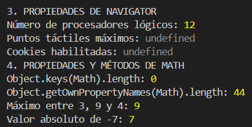
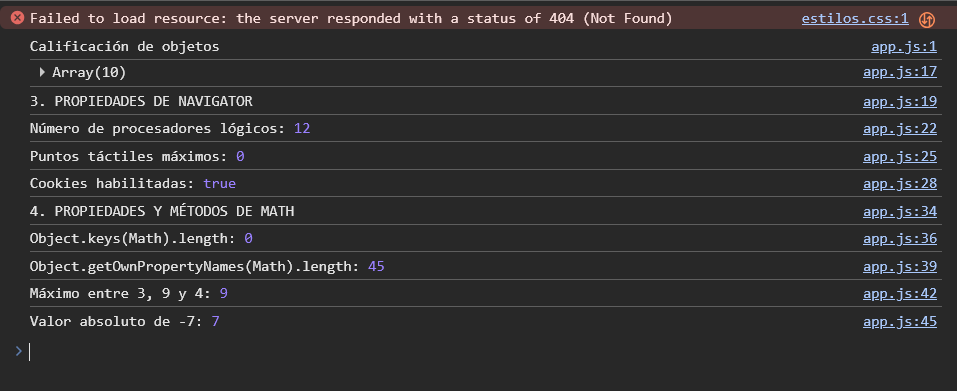

# UT03 - A1: Objetos predefinidos

## 1. Clasificación de objetos

| Nombre | typeof | Familia |
|---|---|---|
| Math | object | Nativo |
| Date | function | Nativo |
| JSON | object | Nativo |
| window | object | Navegador |
| document | object | Documento |
| location | object | Navegador |
| navigator | object | Navegador |
| localStorage | object | Navegador |
| console | object | Entorno |
| setTimeout | function | Entorno |
| alert | function | Navegador |
| Intl | object | Nativo |
| screen | object | Navegador |
| history | object | Navegador |

## 3. Prueba con Node.js

En mi prueba de Node.js:
- `hardwareConcurrency`: 12.
- `maxTouchPoints`: undefined.
- `cookieEnabled`: undefined.
- `Object.keys(Math).length`: 0.
- `Object.getOwnPropertyNames(Math).length`: 44.
- `Math.max(3, 9, 4)`: 9.
- `Math.abs(-7)`: 7.

Los valores de `navigator` pueden cambiar según el entorno. En Node.js, algunas propiedades pueden devolver `undefined`.

## 4. Propiedades de navigator

- `hardwareConcurrency`: indica el número de procesadores lógicos. En mi prueba aparece 12.
- `maxTouchPoints`: indica el número máximo de puntos táctiles admitidos. En mi prueba aparece `undefined`.
- `cookieEnabled`: indica si las cookies están habilitadas. En mi prueba aparece `undefined`.

## 5. Propiedades y métodos de Math

`Object.keys(Math).length` devuelve 0 porque las propiedades de `Math` no son enumerables.

`Object.getOwnPropertyNames(Math).length` devuelve 44 en mi prueba de Node.js porque cuenta todas las propiedades propias de `Math`, incluidas las no enumerables.

`Math.max(3, 9, 4)` devuelve 9 porque es el número mayor.

`Math.abs(-7)` devuelve 7 porque calcula el valor absoluto.